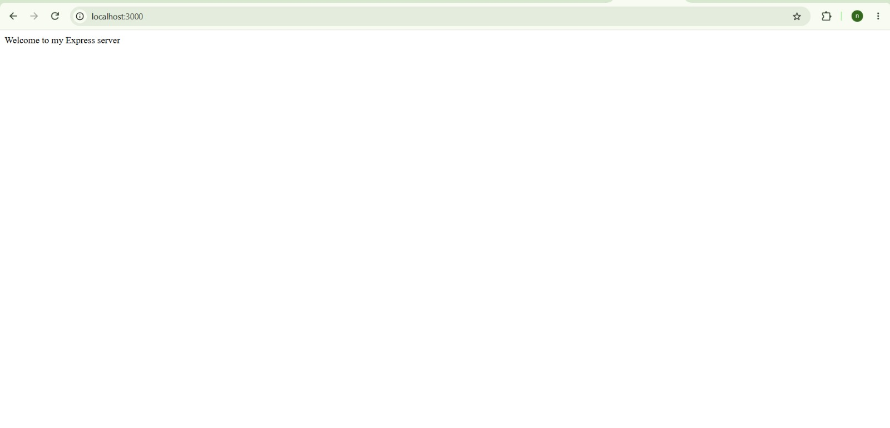
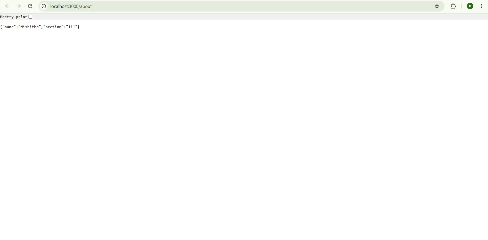
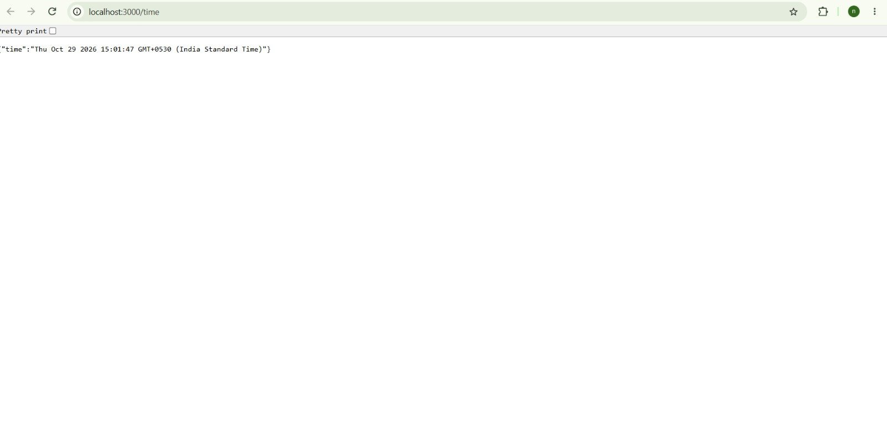
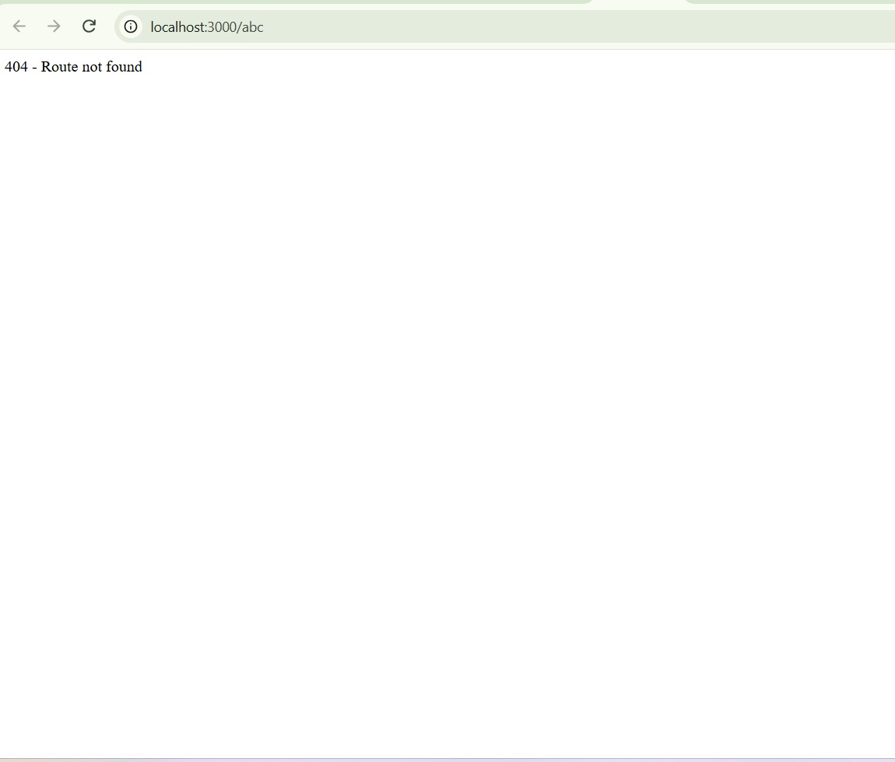

# Lab 1: Node.js and Express server

**Name:** Nishitha · **Registration number:** 252U1R9092 · **Section:** 111

**Live link:** Not deployed yet (will be added after deployment on Render)

## How to run

```bash
cd lab-01
npm install
npm start
```

The server runs on http://localhost:3000.
Optional environment variable: `PORT` (default 3000). No other variables are needed.

## Endpoints

| Method | Path | Description | Status |
|---|---|---|---|
| GET | / | Welcome text | 200 |
| GET | /about | JSON with name and section | 200 |
| GET | /time | JSON with current date and time | 200 |
| any | any other path | "404 - Route not found" message | 404 |

## Screenshots









## Notes

- **Problem:** `cd lab-01` gave "Cannot find path ... because it does not exist".
  **Solution:** `lab-01` had been created outside the repository folder. I moved it inside the repository with `Move-Item` and used the correct path `cd backend-development-lab1\lab-01`.
- **Problem:** `node_modules` must not be uploaded to GitHub.
  **Solution:** I added a `.gitignore` file containing `node_modules/` and `.env` before the first commit.
- **Problem:** The 404 handler must only run for unknown paths.
  **Solution:** I placed `app.use(...)` after all the routes, so it is checked last.