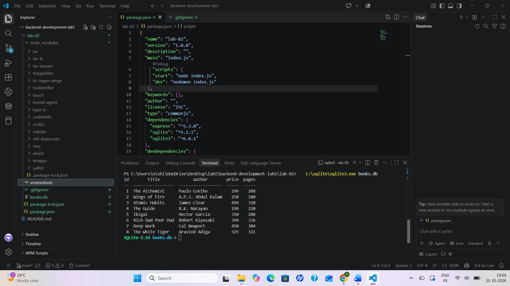
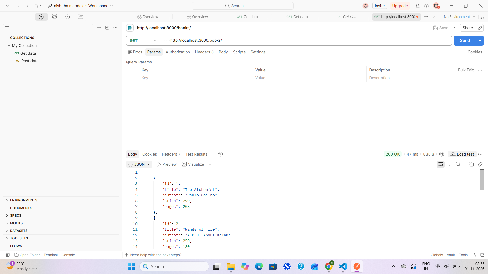
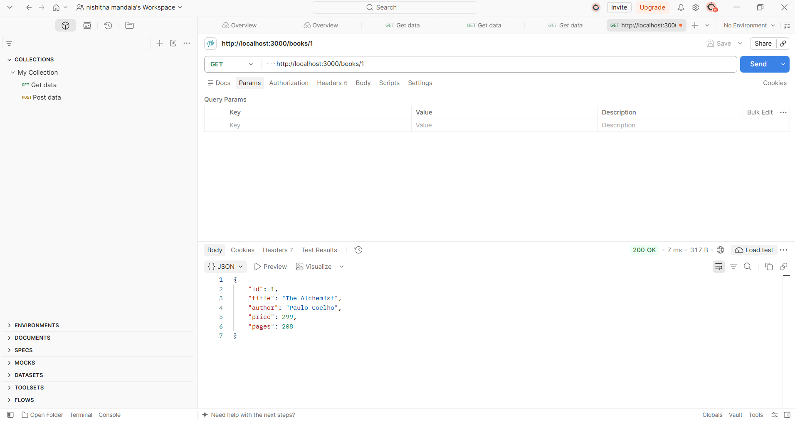
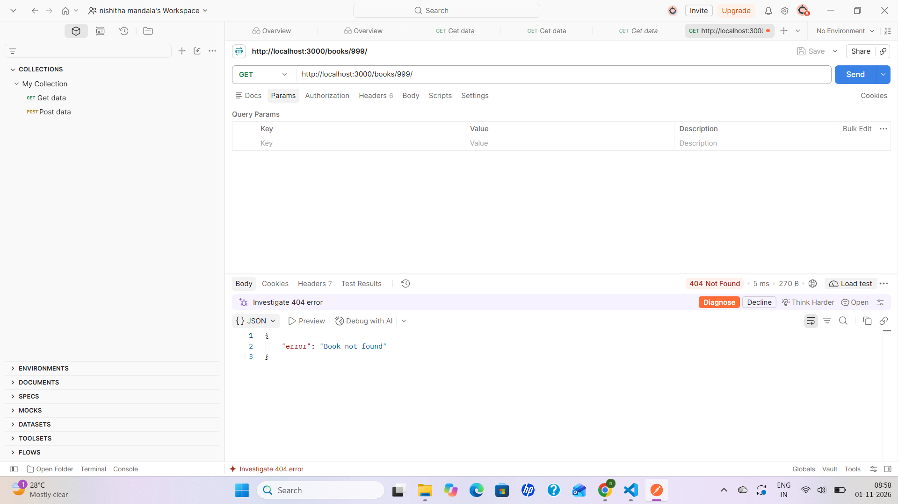
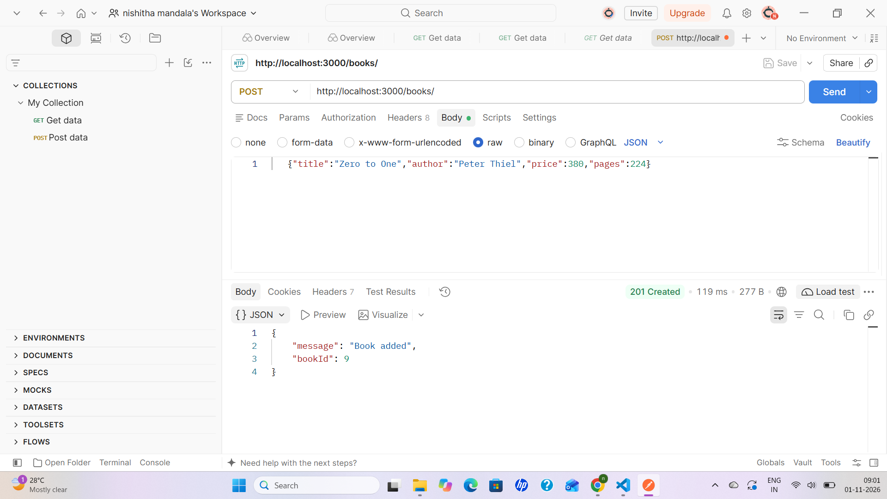
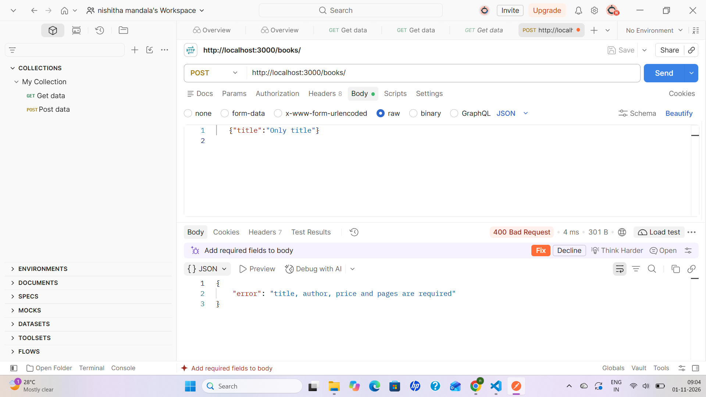
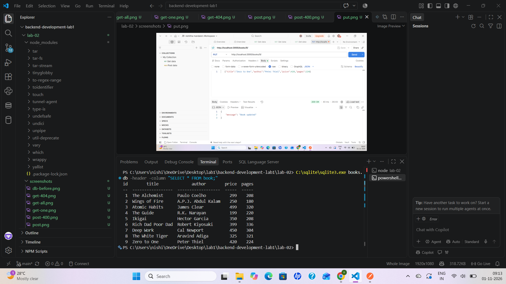
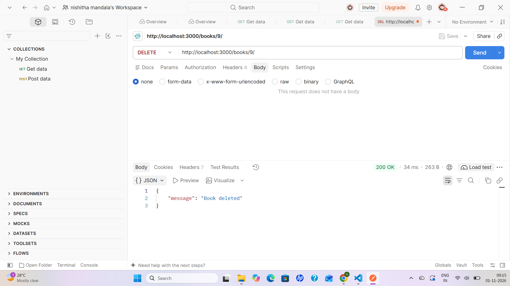

# Lab 2: SQLite database and CRUD routes

**Name:** Nishitha · **Registration number:** 252U1R9092 · **Section:** 111

**Live link:** https://lab2-books.onrender.com/books/

## How to run

```bash
cd lab-02
npm install
npm start        # or: npm run dev (restarts on every change using nodemon)
```

The server runs on http://localhost:3000.
Optional environment variable: `PORT` (default 3000). No other variables are needed.
The database file `books.db` (table `book`) is included in this folder.

## Endpoints

| Method | Path | Description | Success status |
|---|---|---|---|
| GET | /books/ | Get all books | 200 |
| GET | /books/:bookId/ | Get one book (404 if not found) | 200 |
| POST | /books/ | Add a new book (400 if fields are missing) | 201 |
| PUT | /books/:bookId/ | Update an existing book (404 if not found) | 200 |
| DELETE | /books/:bookId/ | Delete a book (404 if not found) | 200 |

All queries use `?` placeholders, so user input is never joined into the SQL string.

## Screenshots


















## Notes

- **Problem:** `lab-02` was first created outside the repository folder, so Git could not see it.
  **Solution:** I moved it inside the repository with `Move-Item` and opened the repository folder in VS Code.
- **Problem:** Running the SQLite CLI from the wrong folder created an empty `books.db` and gave "no such table: book".
  **Solution:** I deleted the empty file and ran the command from inside `lab-02`.
- **Problem:** Source Control showed thousands of changes because `node_modules` was not ignored yet.
  **Solution:** I created `.gitignore` with `node_modules/` and `.env`.
- On Render's free plan the file system is temporary, so changes from POST, PUT and DELETE are lost when the service restarts. The `books.db` in the repository is the starting data.