# Lab 3: REST API, query parameters, validation, debugging

**Name:** Nishitha · **Registration number:** 252U1R9092 · **Section:** 111

**Live link:** Not deployed yet (will be added after deployment on Render)

## How to run

```bash
cd lab-03
npm install
npm start        # or: npm run dev (restarts on every change using nodemon)
```

The server runs on http://localhost:3000.
Optional environment variable: `PORT` (default 3000). No other variables are needed.
The database file `books.db` (table `book`) is included in this folder.

## Endpoints

| Method | Path | Description | Success status |
|---|---|---|---|
| GET | /books/ | List books with search, sort, pagination and price filter | 200 |
| GET | /books/:bookId/ | Get one book | 200 |
| POST | /books/ | Add a book (validated) | 201 |
| PUT | /books/:bookId/ | Update a book (validated) | 200 |
| DELETE | /books/:bookId/ | Delete a book | 200 |

### Query parameters for GET /books/

| Parameter | Default | Meaning |
|---|---|---|
| search_q | empty | Partial, case-insensitive match on the title (LIKE) |
| order_by | id | One of: id, title, author, price, pages |
| order | ASC | ASC or DESC |
| limit | 10 | Number of rows (1 to 100) |
| offset | 0 | Rows to skip |
| min_price | none | Only books with price at or above this |
| max_price | none | Only books with price at or below this |

### Status codes

| Code | When |
|---|---|
| 200 | Successful GET, PUT or DELETE |
| 201 | Book created |
| 400 | Bad input: missing title or author, non-numeric price, bad id, bad query value, invalid JSON |
| 404 | Book id does not exist, or unknown route |
| 500 | Unexpected server error |

Every error has the same format: `{ "message": "..." }`.

## Postman test list

| # | Request | Expected |
|---|---|---|
| 1 | GET /books/?search_q=the | 200 |
| 2 | GET /books/?order_by=price&order=DESC | 200 |
| 3 | GET /books/?limit=3&offset=3 | 200 |
| 4 | GET /books/?min_price=250&max_price=400 | 200 |
| 5 | GET /books/?search_q=a&order_by=price&limit=5&min_price=200 | 200 |
| 6 | POST /books/ (valid body) | 201 |
| 7 | PUT /books/9/ (valid body) | 200 |
| 8 | DELETE /books/9/ | 200 |
| 9 | GET /books/999/ | 404 |
| 10 | GET /books/abc/ | 400 |
| 11 | GET /books/?order_by=password | 400 |
| 12 | POST without title | 400 |
| 13 | POST with price "abc" | 400 |
| 14 | PUT /books/999/ | 404 |

## Screenshots

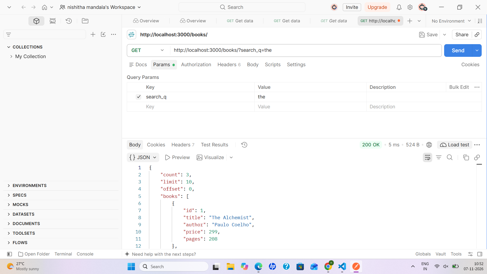

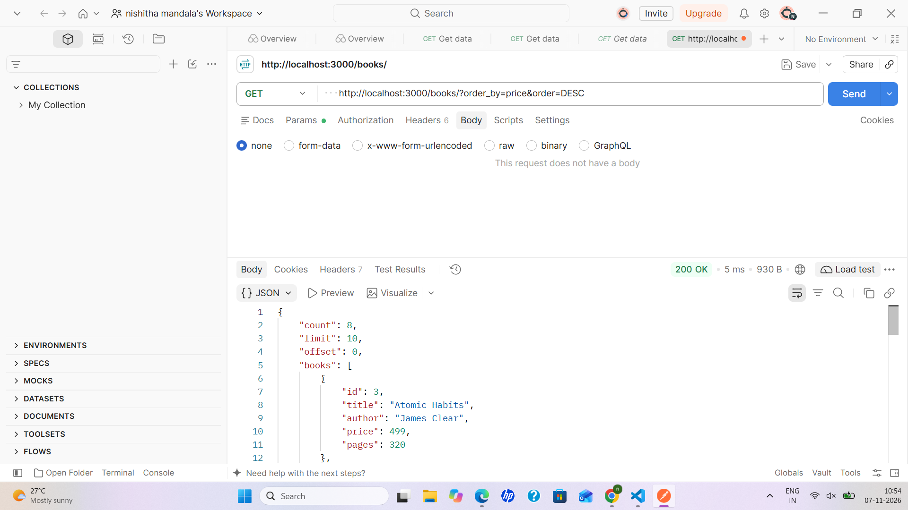

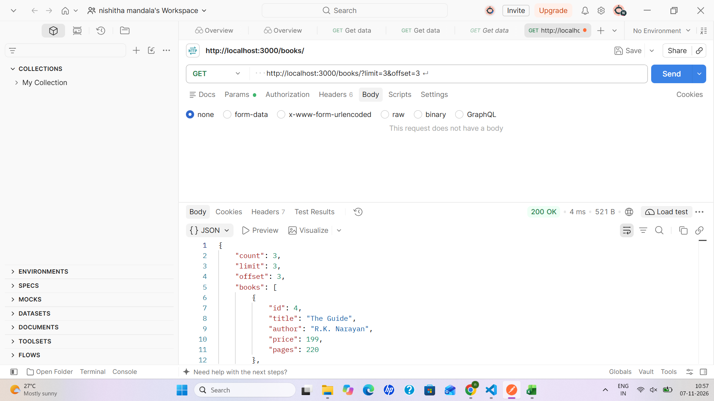

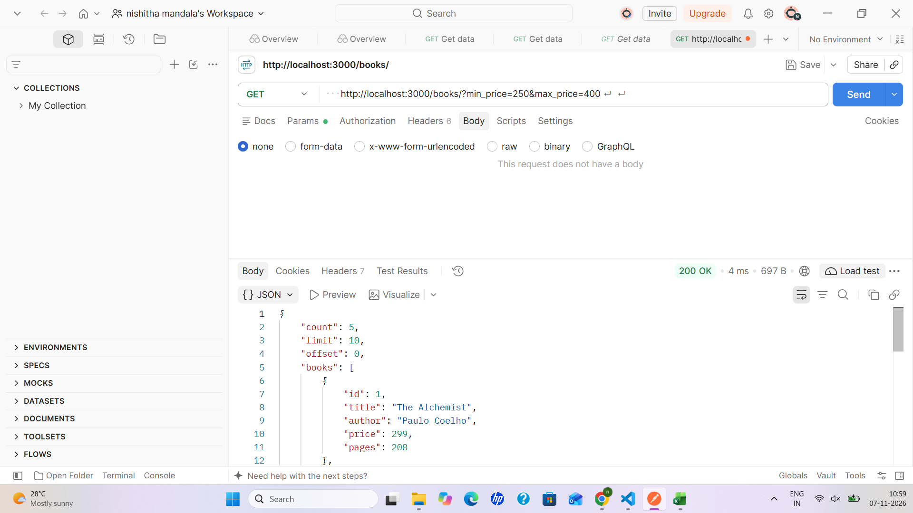

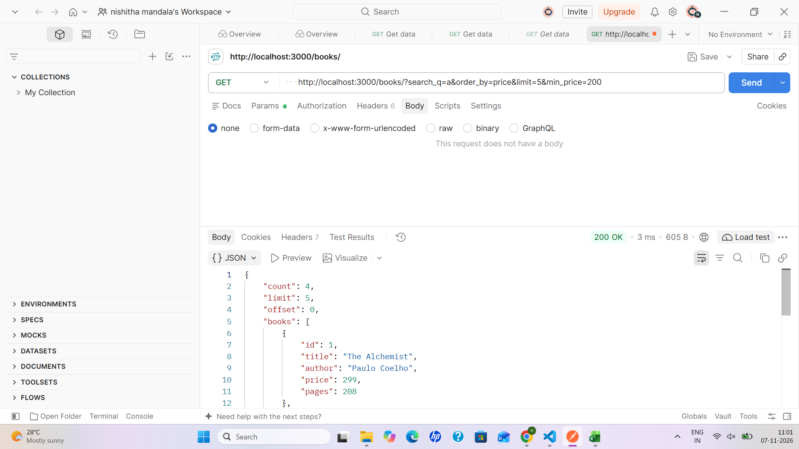

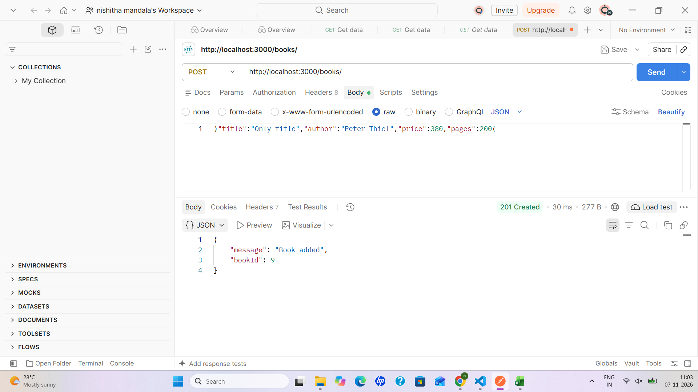

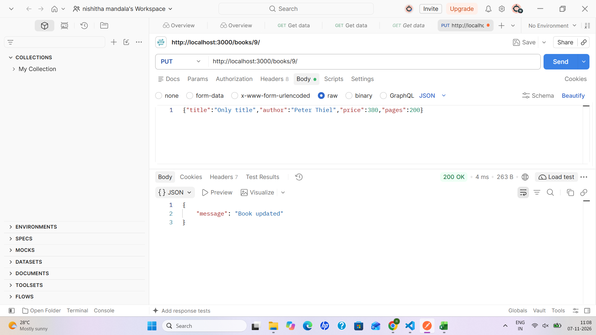

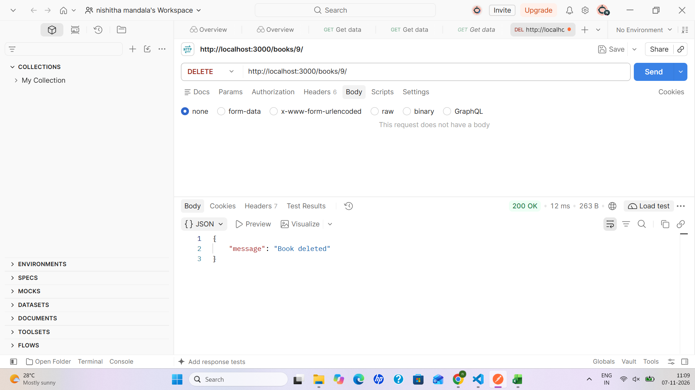

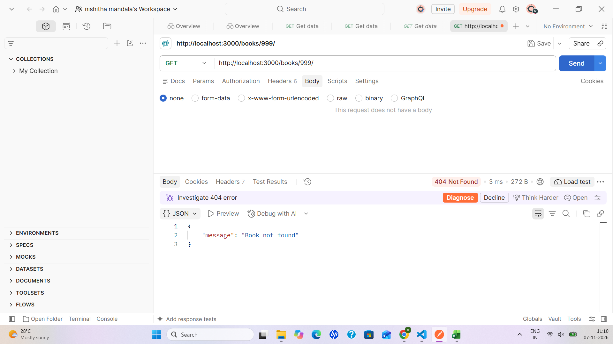


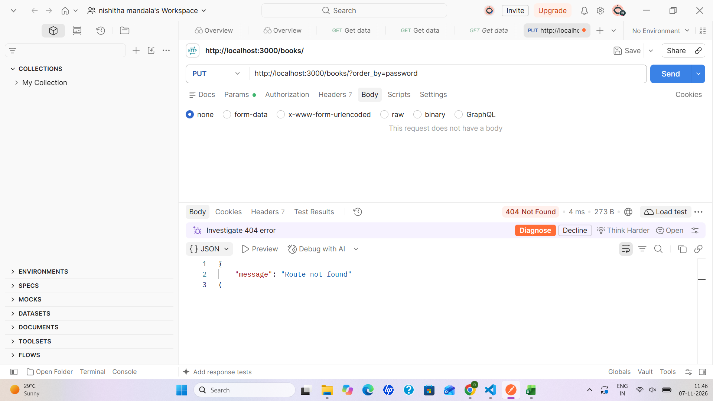

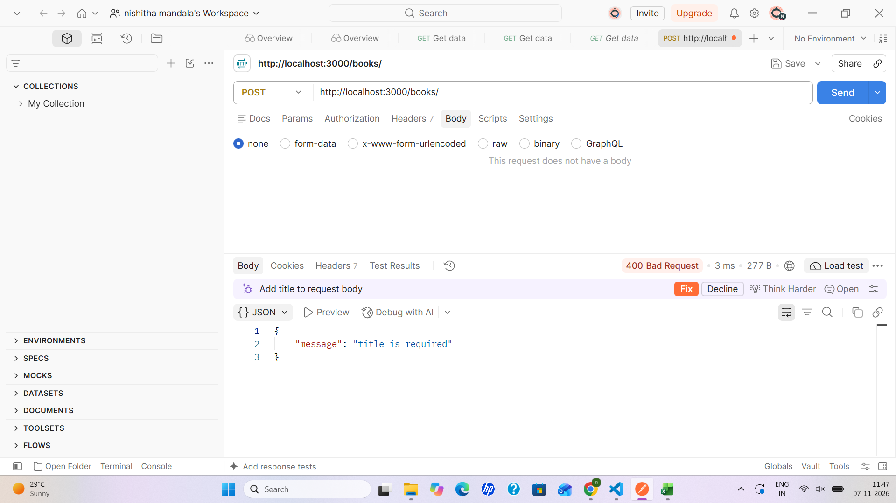

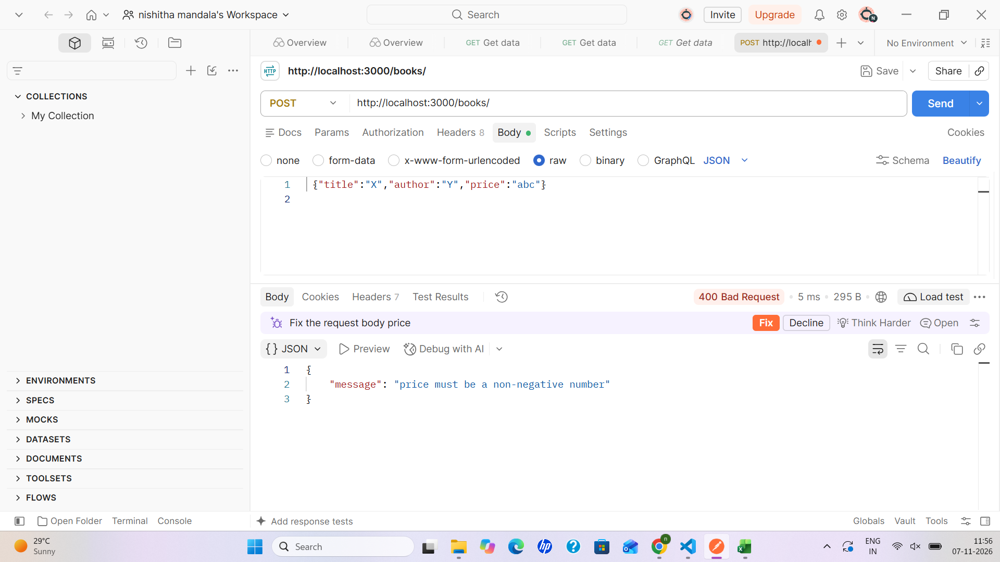

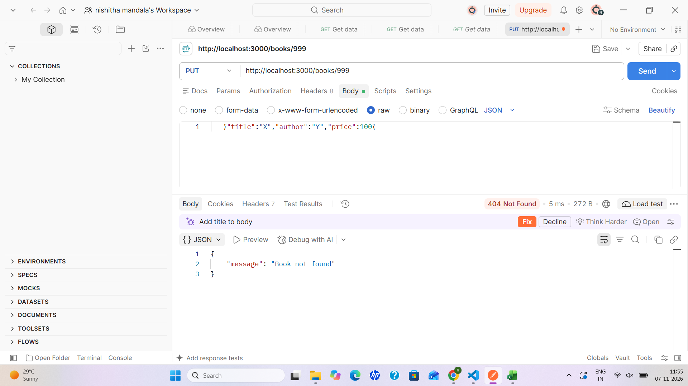

## Notes

- **Design choice:** Placeholders (`?`) cannot be used for column names, so `order_by` and `order` are checked against a fixed whitelist before they are put into the query. All other user input goes through placeholders.
- **Problem:** Postman showed `getaddrinfo ENOTFOUND books` when I typed only `/books/...`.
  **Solution:** I used the full URL starting with `http://localhost:3000`.
- **Problem:** A PUT request to a missing book returned 400 "title is required" instead of 404.
  **Solution:** The body was empty. I added a raw JSON body, and the server then returned 404. The server checks the input before it checks whether the record exists.
- **Debugging exercise:** (add here what you fixed in the faculty's broken version: the port conflict, the wrong import path, the table-name typo and the missing await).
- On Render's free plan the file system is temporary, so changes from POST, PUT and DELETE are lost when the service restarts.